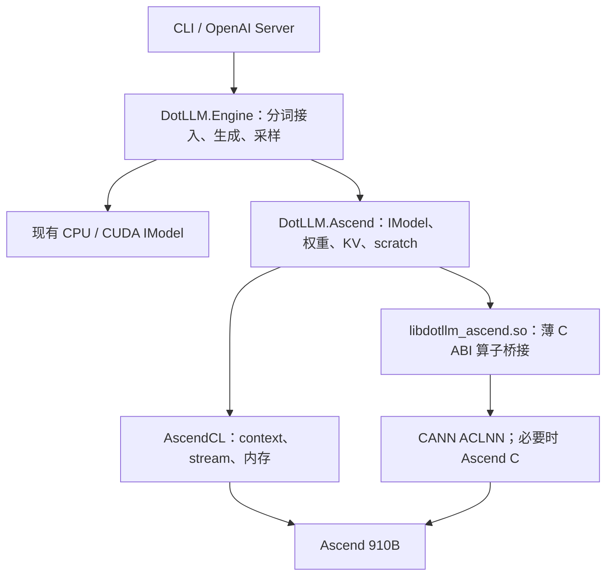

# DotLLM Ascend 910B 初步适配方案

更新日期：2026-10-24。阶段：**单卡 dense Llama/Qwen2 全模型、连续 KV 与 CLI/API 基线已完成，910B4 完整套件 16/16 PASS，退出 0**。当前默认 FP32 权重/激活、FP16 KV/RoPE 表；首次 all-FP16 全模型未通过冻结误差门槛，因此不作为默认模型路径。构建和运行见 [Ascend runtime](ASCEND_RUNTIME.md)，数值、服务与 CPU 对照见 [完整验收结果](ASCEND_FULL_RESULTS.md)，最初 Linear bring-up 见 [M0 记录](ASCEND_M0_RESULTS.md)。资源调查和工期估计保留历史日期，不作为当前配额承诺。

详细源码核对、现有镜像/任务证据及验证步骤见 [Ascend 实现研究](ASCEND_IMPLEMENTATION_RESEARCH.md)。后续补查确认了 CANN 8.3.RC1 的历史可用镜像，并发现生成器 device 参数与 logits 行数需要显式适配；以下内容已同步调整。

## 1. 目标与推荐路线

新增独立的 `DotLLM.Ascend` 后端，保留 C# 的模型加载、Transformer 编排、分词、采样与服务接口，通过 AscendCL 管理设备，通过 CANN ACLNN 算子执行计算。首版交付单张 Ascend910b4-64G 上的 dense Transformer 推理：GGUF 加载、FP32 展开权重与激活、连续 FP16 KV-cache、prefill、逐 token decode，以及 CLI 和 OpenAI 兼容服务接入。

建议采用 `C# + AscendCL P/Invoke + 薄 C ABI 算子桥接库`。AscendCL 的初始化、内存、context、stream 接口直接绑定；ACLNN 的 tensor 描述、两段式调用与错误处理收敛在小型 C++ 桥接库中，对外仅暴露 C ABI。推理不依赖 Python、torch_npu 或外部推理服务。这个设计沿用项目的 .NET 编排习惯，同时让 CANN 头文件负责复杂参数的类型检查。[cite:1][cite:2][cite:3]

首版限定模型配置和数据格式，通过 capability 校验拒绝未支持的组合。优先使用现成 ACLNN 算子，只有通用 RoPE 等确有接口限制的地方再考虑 Ascend C；首轮性能优化放在正确性验收之后。

## 2. Git 基线与当前结果

| 项目 | 结果 |
| --- | --- |
| 原工作分支 | `issue/256-continuous-batching-paged-attention` |
| 原分支 HEAD | `1ceba8c` |
| 新准备分支 | `prepare/ascend-910b-bringup` |
| 新分支基线 | `origin/main`，`d88040451d7db56e5dfef9d5754ad0955b0f7fe5` |
| 远端主线核实 | `git ls-remote origin refs/heads/main` 返回相同 SHA |
| 已完成 | runtime/tensor、FP32/FP16 算子、全模型 forward、KV、CLI/API、构建与实机验收 |
| 后端实现与实机结果 | `AscendTransformerModel : IModel` 与 run/chat/serve 已接入；HJ 单卡 run `[internal resource ID]` 完整 16 阶段 PASS，套件退出 0；此前 M0 run `[internal resource ID]` 记录单独保留 |

原分支相对主线的六个 Continuous Batching / PagedAttention 提交保留在原分支。首版 Ascend 从主线独立开发；第二阶段再接入已存在的批处理工作，降低 PR 依赖。

仓库 `CONTRIBUTING.md` 要求 issue 驱动、从 main 建立 `issue/{number}-{description}` 分支。当前实验代码仍保存在本地准备分支，未公开发布 issue、commit 或 PR。正式提交上游前，需使用第 10 节建立 issue，并改为对应 issue 分支；当前实验状态尚未满足该贡献流程。[cite:1]

## 3. Ascend 资源核实

2026-10-22 通过 Merlin `control-plane=cn` 查询目标组，返回如下当时状态：

| 字段 | 返回值 |
| --- | --- |
| group | `[internal resource]` |
| group SID | `2079` |
| cluster / SID / dc | `[internal resource]` / `20` / `hl` |
| queue | `[internal resource] |
| node level / type | `ascend` / `gpu` |
| 硬件型号 | `Ascend910b4-64G` |
| `total.gpu` | `16` |
| `used.gpu` | `16` |
| `allocatable.gpu` | `16` |
| 请求 ID | `202610220202422E2B8ABD9A1CE70274AB` |

同一次组详情中，`allocatable` 与 `capacity/total` 相同而 `used=16`。这些是平台聚合字段，不能把 `allocatable=16` 解读为 16 张空闲卡，也不能据此归因具体占用任务。

`my-group-resources list` 在 `filter={"type":"gpu","group_name_contains":"[internal resource]","cluster_name_contains":"[internal resource]"}` 下只返回 AI 队列的 H20 余量，没有返回 Ascend 行。请求成功，`ResponseBase.code=0`，请求 ID 为 `2026102202020386639D8DE2B2096DDB7A`。因此已确认组内存在目标 Ascend 队列，尚未确认当前账号有可立即调度的 Ascend 余量。

建议开发阶段使用单张卡；如果平台最小分配规格大于一张，以平台实际规格为准，测试进程只选择一个逻辑设备。首版不需要 16 卡并行。后续 HJ 单卡任务已经实际调度并完成 smoke，证明该集群/队列的一张卡请求可执行，不推断其他队列的最小规格。

当前本地能运行 `.NET SDK 10.0.100`，存在 `cmake`、`g++` 和 `npu-smi` 命令；但 `npu-smi info` 没有输出设备信息，文件检索也未发现可用的 CANN 头文件/运行库。存在命令不等于具备 NPU 开发环境，M0 必须在目标 worker 上验证。

进一步核实：当前 `vayne` CPU Master（`[internal resource]`）无活跃 Worker，无 `/dev/davinci*`，`npu-smi` 是 0 字节文件。已有公开可读镜像 VID `d6nakm3c77u7jl17ea90` 状态 OK；2026-10-12/15 的历史 NPU 日志确认 x86_64、CANN 8.3.RC1、driver 25.5.0、torch_npu 2.7.1。本轮使用该镜像先后提交保障队列与同机房 Spot 单卡 smoke；两次预检均成功，但任务均保持 queued、无 pod，已停止。最新保障队列 GPU、CPU、内存均已用满；Spot 未返回具体失败原因。历史运行不替代本次桥接验证。

2026-10-24 补充：同组 `[internal resource]` 已使用上述镜像完成自有 C++ bridge 与 C# 实机测试。
环境为 Debian 12 x86_64、g++ 12.2.0、CANN/ops 8.3.RC1、npu-smi 25.5.0、
.NET 10.0.0；7 组 Linear shape 各 3 次输入，以及复制和正常生命周期检查全部通过。
HL 开发机申请 `[internal resource ID]` 仍为 Pending，按此前约定保留。

## 4. 代码接入点

基线中 `IBackend` 只包含设备计数、分配、复制和通信，没有 GEMM、RMSNorm 或 attention 接口。CPU 与 CUDA 都通过独立的 `IModel.Forward()` 完成推理。仅实现 `AscendBackend : IBackend` 不足以让 DotLLM 使用 NPU。[cite:2]

| 现有位置 | 适配动作 |
| --- | --- |
| `src/DotLLM.Core/Backends/IBackend.cs` | 新增实现，首版不扩张公共接口；多设备通信明确拒绝 |
| `src/DotLLM.Core/Models/IModel.cs` | `AscendTransformerModel` 实现两个 Forward 重载 |
| `src/DotLLM.Core/Tensors/ITensor.cs` | `AscendTensor` 持有 device pointer，显式记录设备 ID |
| `src/DotLLM.Models/Gguf/*` | 复用 GGUF、ModelConfig、tokenizer 和 chat template 解析 |
| `src/DotLLM.Models/Architectures/TransformerWeights.cs` | 复用权重映射，正确处理 GGUF 矩阵维度、bias 和 tied embeddings |
| `src/DotLLM.Models/DotLLM.Models.csproj` | 最小方案增加对 `DotLLM.Ascend` 的 `InternalsVisibleTo`，避免复制内部解析逻辑 |
| `src/DotLLM.Cuda/CudaTransformerModel.cs` | 参考 forward 顺序、scratch 复用、最终 logits 回传 |
| `src/DotLLM.Cuda/CudaKvCache.cs` | 参考连续 cache 的生命周期与设备更新；重新实现 ACL 数据路径 |
| `src/DotLLM.Cli/Commands/{Run,Chat,Serve}Command.cs` | 增加 `--device ascend[:index]` 的解析、模型加载、KV factory 和设备信息 |
| `src/DotLLM.Server/{ServerStartup,ServerOptions}.cs` | 增加 Ascend 模型加载与 KV factory，继续使用现有服务调度 |
| `src/DotLLM.Engine/TextGenerator.cs` | 复用采样与流式输出，使用 Ascend KV factory |
| `tests/DotLLM.Tests.Unit/Cuda/CudaLogitComparisonTest.cs` | 参考强制同 token 的逐步 logits 对比方法，新增真正含断言的 Ascend 验证 |
| `dotLLM.slnx` 与相关 `.csproj` | 注册后端、测试和 RID native 资产 |

`DevicePlacement` 和 `ITensor.DeviceId` 目前以 `-1` 表示 CPU、非负整数表示加速设备，但命名偏向 GPU。首版在 Ascend 后端内解释 ordinal，并且复制时检查 tensor 类型和所属 context，防止相同编号的 CUDA/NPU tensor 被混用。没有必要为首版重构全仓库 device abstraction。

主线的 CPU/GPU forward 与部分文档存在差异，例如 `docs/ARCHITECTURE.md` 中仍展示旧的 native CUDA library 图。方案以固定 commit 的源码为准；CUDA 当前实际路径是 Driver API + PTX + cuBLAS。[cite:2]

## 5. 后端设计

### 5.1 模块和边界



建议文件组织：

```text
src/DotLLM.Ascend/
  DotLLM.Ascend.csproj
  AscendBackend.cs
  AscendDevice.cs
  AscendContext.cs
  AscendStream.cs
  AscendTensor.cs
  AscendModelLoader.cs
  AscendWeights.cs
  AscendForwardState.cs
  AscendKvCache.cs
  AscendTransformerModel.cs
  AscendOps.cs
  Interop/
    AscendClApi.cs
    AscendNativeMethods.cs
    AscendLibraryResolver.cs
    AscendException.cs
native/ascend/
  CMakeLists.txt
  include/dotllm_ascend.h
  src/ops.cpp
tests/DotLLM.Tests.Ascend/
  DotLLM.Tests.Ascend.csproj
```

模型计算顺序仍由 C# 编排。native 桥接库只处理算子调用和 ACL 描述对象，不承接分词、模型格式、采样或服务。桥接层接口使用 `Linear`、`RmsNorm`、`RoPE`、`Attention` 等粒度，传 device pointer 和 shape/stride 等元数据；不跨 P/Invoke 传完整 tensor 数组。[cite:1]

### 5.2 运行时、资源与构建

- AscendCL 生命周期：进程级初始化共享；每个模型拥有显式 context 和单 stream。进入执行线程时设置正确 context，避免 ASP.NET 线程切换后使用错误设备。
- 权重、KV、scratch 和 workspace 使用设备内存；`IDisposable` 确定性释放。加载中途失败也必须按已获取资源的逆序清理。
- `aclFinalize` / device reset 不能由任意模型单独调用并破坏其他模型；通过共享运行时所有权管理，仅在最后一个 owner 退出后处理全局清理。
- 权重上传可在加载阶段同步完成。推理中的异步 H2D/D2H 使用 ACL host buffer 或满足目标版本要求的固定 host buffer，保留到 stream 完成；不把短期 `fixed` 的 managed pointer 交给返回后仍执行的异步复制。
- 权重和 KV 常驻设备。forward 正常路径仅上传 token/position 等小输入，完成后取回 FP32 logits；激活不在每层往返 CPU。
- workspace 可复用内存容量，但其扩大或释放必须避开未完成的任务。不得仅按 shape 缓存 `aclOpExecutor` 并假定它可重复执行；具体生命周期、描述对象释放与复用能力按目标 CANN 文档和实机验证确定。[cite:3][cite:4]
- native 桥接库通过 CMake 显式构建。普通 CPU build 不要求安装 CANN，不在全仓库 build 时自动搜索或加载 NPU 库；选择 Ascend 时再检查动态库和必需符号。
- 首版支持 Linux。先核实 worker 的 `uname -m` 和 OS/glibc，再选择 `linux-x64` 或 `linux-arm64`；两种 RID 都列为后续打包目标，未经实测的组合不声明已支持。
- 系统 CANN/driver 由匹配的 worker 镜像提供；NuGet/RID 资产只打包自有桥接库。ABI 错误信息包含操作名、返回码、设备、shape 和 CANN 版本。

### 5.3 权重与精度

受测真实模型为 SmolLM-135M 与 Qwen2.5-0.5B-Instruct Q8_0 GGUF。加载时按行/块用 bounded unmanaged staging 精确展开为 FP32，检查非有限值，一次上传；norm/bias 同样保留 FP32。共享 embedding/LM head 只保留一份设备存储。[cite:2]

初始 FP16 权重/激活在短 prompt 的全模型累计误差超出冻结门槛；最终 correctness path 使用 FP32 权重、残差、激活、Linear/Norm/SwiGLU/attention，FP16 KV 与 RoPE 表。F32/F16/Q8_0 **源文件格式**由六个 tiny fixture 分别验证，不能把 Q8_0 加载展开称为 NPU 量化推理。

权重内存约 `4 × loaded elements` 字节；SmolLM `538060032 B`，Qwen `2520669696 B`。KV、scratch 和 runtime workspace 必须另外预留。本次只验证两个小型 dense 模型，不据此宣称所有 7B/更大模型可装载。FP16 kernel 21 次 Linear 数值检查独立保留，FP16 fast-model 路径需重新通过同一门槛后再启用。

### 5.4 算子映射与限制

下表是候选映射。精确符号、版本、shape、stride 与 dtype 支持必须在目标镜像中验证；已查到的官方文档来自不同历史版本，不能据此指定 worker 的 CANN 版本。

| DotLLM 操作 | 首版实现 | 正确性或兼容重点 |
| --- | --- | --- |
| Embedding | `aclnnEmbedding` 或 gather 类接口 | 索引类型、token 边界、词表行布局 [cite:5] |
| Linear / LM head | `aclnnMatmul` / `aclnnMm`，decode 也先走矩阵乘 | `X[S,K] × W[N,K]^T`；明确 stride/转置，不复制 cuBLAS 的 column-major 技巧 [cite:3] |
| RMSNorm | `aclnnRmsNorm`；需要时使用 FP32 基础算子组合 | eps、归一化维度、统计量精度 |
| Residual add / bias | Add 类 ACLNN | 广播和 alias 约束 |
| SwiGLU | SiLU + Mul，确认后再使用融合接口 | gate/up 顺序和激活语义 |
| RoPE | 优先核实 llama.cpp 使用的 `aclnnRotaryPositionEmbedding`；基础算子对照/fallback，缺口再用 Ascend C | Norm 与 NeoX、partial rotary；旧 ApplyRotaryPosEmb 的限制不能推广到所有 RoPE 接口 [cite:6] |
| Prefill attention | 先用设备上的 QK、mask、softmax、PV 组合验证；随后接入 PromptFlashAttention / FlashAttentionScore 候选 | 因果 mask、GQA、有效长度、完整 prompt 与追加 chunk 的 query offset |
| Decode attention | `aclnnIncreFlashAttentionV3` 候选，基础算子版本作为对照 | query S=1，显式有效 KV 长度与 KV head 数 [cite:4] |
| KV append | 连续位置批量 D2D，离散位置按行或 scatter | 只更新有效范围；rollback 后旧区域不得被 attention 读取 |
| Logits cast | cast 到 FP32 后回传 | 只返回最后位置；遵守现有 `IModel` 合约 |

旧版 `aclnnApplyRotaryPosEmb` 文档限制四维 BSND、headDim=128，使用 split-half 旋转。不能将它直接用于所有小模型，也不能把 Norm RoPE 当成 NeoX RoPE。即使新版本放宽维度，也必须先逐元素比较，再开启融合快路径。[cite:6]

详细源码核对发现 llama.cpp CANN 采用另一接口 `aclnnRotaryPositionEmbedding`，显式区分 half/interleaved 和 partial rotary；这是首版更合适的融合候选，但需在目标 CANN 8.3.RC1 中检查符号和约束。融合 attention 同时核实 `FusedInferAttentionScoreV2`，不预设最新上游代码可整体运行于旧镜像。

已核实的 `aclnnIncreFlashAttentionV3` 在 A2 产品上支持 GQA 与分页参数，并限制 query 的 S=1。初版只使用连续 KV；分页参数留到第二阶段。它的存在不代表 DotLLM 已具备 Continuous Batching 支持。[cite:4]

llama.cpp 的 CANN 后端说明和源码设计可作为算子/布局参考；其文档列有 910B 与 FP16 支持，也提供 ACLNN/Ascend C 的实际后端路线。它不能替代 DotLLM 数值验证。[cite:7]

### 5.5 KV-cache 与 forward 合约

建议 cache 采用逻辑 `BSH`，物理存储为每层两块 `[maxSequenceLength, numKvHeads × headDim]` FP16 连续内存。Q/K/V 的 reshape 和描述 stride 按 attention 接口转换；如果目标接口不接受该 view，显式增加并计量 layout conversion，不能假设 reshape 总是零成本。

每个请求拥有自己的 cache；一个模型的执行和 scratch 由单 owner 串行使用。`CurrentLength`、positions、layer index、设备/context 必须校验。首版支持从 position=0 的完整 prefill、连续追加 decode，以及 cache rollback/reset；对离散位置覆盖和 prefix 恢复要么验证并实现，要么显式拒绝，不静默退回 CPU KV。

cache 容量按实际 `MaxLength` 分配。内存公式为 `2 × layers × maxLength × kvHeads × headDim × 2` 字节；模型加载前把权重、KV、scratch、workspace 与剩余设备内存一起核算。

`Forward(..., kvCache)` 返回最后输入 token 的 host FP32 logits `[1, vocabSize]`。prefill、decode 与无 cache 路径的有效 attention 长度一致。服务注册专用 Ascend KV factory；分页、量化 KV 或 speculative 等尚未验证的选项明确返回不支持。

生成器目前统一传 `deviceId=-1`，初版 Ascend 与现有 CUDA model 一样使用加载时绑定的设备执行并返回 host tensor；显式非负 ID 校验与绑定设备一致。CPU 实际返回 `[seqLen,vocabSize]`，CUDA 返回 `[1,vocabSize]`，测试各自取最后一行。prefix cache 目前只截断复用 CPU cache 类型，因此初版 Ascend 显式不启用 prefix reuse。

## 6. 首版范围和后续阶段

| 首版交付 | 后续阶段 |
| --- | --- |
| Linux、单个显式 NPU 设备 | 多卡 TP/PP、HCCL |
| SmolLM-135M / Qwen2.5-0.5B dense Llama/Qwen2 路径 | MoE、MLA、多模态 |
| F16/F32 GGUF，验证后的 Q8_0 加载展开 | 压缩权重常驻、W8A8/W4A16、GGUF 量化 GEMV |
| FP16 连续 KV、单请求 prefill/decode | Paged KV、prefix block sharing、KV 量化 |
| CLI run/chat/serve、串行服务生成、SSE | Continuous Batching、混合 CPU/NPU offload |
| ACLNN 基础实现与受约束融合快路径 | graph replay、NZ weight packing、融合算子 |
| 显式配置校验与失败清理 | LoRA、speculative、完整 diagnostics hooks |

在 SmolLM 闭环通过后，用仓库现有 fixture 的 Qwen2.5-0.5B-Instruct GGUF 扩展验证 projection bias、NeoX RoPE、tied embeddings 和不同词表。具体模型 artifact、tensor 格式和配置先固定并记录；Qwen3 的 QK norm 单独列扩展测试，不能因为主仓库有通用配置就自动宣称 Ascend 支持所有 Qwen。

## 7. 实施里程碑

以下是单人开发的工程估算，不是交付承诺；从目标 worker 和 CANN 开发镜像可用时起算。没有空闲卡时，源码、binding、构建及 host 测试可先推进，实机门槛不能省略。

| 阶段 | 工作 | 验收 | 估算 |
| --- | --- | --- | --- |
| M0 | 资源/镜像核实；记录 SoC、CPU 架构、driver/firmware/CANN/ops；编译官方 matmul smoke | 设备枚举、H2D/D2H 和 FP16 matmul 确实运行于目标 NPU | 0.5–1 天 |
| M1 | 后端工程、context/stream/tensor、runtime ownership、native resolver、错误路径 | host build 无 CANN 可完成；实机复制和销毁测试通过 | 1–2 天 |
| M2 | 权重上传、Linear、Norm、SwiGLU、通用 RoPE；基础 attention 与连续 KV | 算子及单层强制输入数值对照通过 | 2–3 天 |
| M3 | 全模型 forward、prefill/decode、logits 回传和初次融合 attention | SmolLM 连续生成；有 cache 与重算对照；Qwen2.5 扩展验证 | 2–3 天 |
| M4 | CLI/Server 接入、SSE、设备诊断、验证文档、benchmark | API 流式生成和重复请求稳定；输出可复现测量 | 1–2 天 |

总量估算约 6.5–11 个工作日。首个风险消减目标是 M0，不在尚未核实镜像和算子兼容性时直接投入全模型实现。

当前验收进展：M0–M4 的单卡 correctness/CLI/API 基线完成。完整套件含全部基础算子、两真实模型各 32 步 teacher forcing、六种 storage fixture、各 13 文本/KV case、异常清理与 18 项 CLI/API 检查，16 阶段 PASS。FP32 默认路径替代最初 FP16 设想；融合 attention/graph/NZ/量化加速仍属下一阶段。独立 firmware query 返回 NA，版本记录保留这一缺口。详见 [完整结果](ASCEND_FULL_RESULTS.md)。

正式实现可按 issue 内的几个小提交推进：runtime → 算子/权重 → forward/KV → CLI/Server → 验证/文档。分页和批处理使用独立后续 issue/PR。

## 8. 正确性验收

### 8.1 环境和硬件执行

- 固定模型文件及 SHA256、GGUF metadata、代码 commit、CANN/ops/driver 版本、OS、CPU 架构和 SoC。
- C/C++ smoke 与 C# binding 使用相同输入运行 matmul，并实际同步后比对输出。
- 必须有设备分配/执行与计时证据。硬件测试被 skip 不能算通过；本地无卡只运行 host 验证。
- 保留一次完整 unload 后内存回归与失败清理结果；不能只展示设备枚举。

### 8.2 数值和状态

对照使用相同模型权重与相同 token IDs。CPU FP32 路径、在相同 token 流上运行的 Ascend 路径，以及必要时的框架参考分别记录，避免 token 自由采样造成输入分叉。

CPU/NPU 各自按实际 `Shape[0]-1` 取最后 logits 行；已有 CUDA diagnostic test 直接取第 0 行且主要打印，不能原样当作验收。数学对照使用相同解码权重与匹配的 RoPE 排列；原始 HF 权重不能直接当作量化 GGUF 的数值金标准。

关键断言包括：

- Linear 转置与 GGUF 维度映射、norm eps、SwiGLU gate 顺序、bias 和 tied embeddings；
- RoPE Norm/NeoX、headDim=64/128、非零位置、partial rotary dimension；
- GQA 的 query/KV head 分组、因果 mask、未填充 KV 区域不可见；
- 整段 prefill 与拆段追加得到一致 logits；token=1 的 prompt 不误走有旧 cache 的 decode 语义；
- 多步强制同 token decode 的 logits 接近参考；rollback 后重新写入与全量重算一致；
- 两个请求各自 KV 的隔离、重复生成与卸载、context/设备不匹配和无效 token/position 的明确错误。

逐算子采用 `abs(error) <= atol + rtol × abs(reference)` 的固定断言；受测 FP16 Linear 为 `atol=0.002, rtol=0.002`，其他算子的独立阈值见 KernelSmoke。全模型预算固定为 `RMS(error) <= 0.03 + 0.015 × RMS(reference)`、`max_abs <= 0.25`、`cosine >= 0.999`。KV split 使用零 atol RMS/max≤0.05，文本 rollback 必须 bit-exact；记录完整误差与阈值，不以全句 greedy 完全一致作为唯一标准。

端到端至少覆盖预先固定的一组英文、中文、代码 prompt，prefill 长度 1/32/128/512，逐步 decode、EOS、上下文边界和连续两次请求。top-k 与 greedy 是辅助指标；接近并列的 top-1 需要检查 logits margin。

### 8.3 产品行为

- `--device ascend:0` 确实创建 Ascend 模型，不能落入 `gpuLayers=0` 的 CPU 分支。
- CLI run/chat 与服务 `/v1/chat/completions` 能使用同一专用 KV factory。
- SSE、usage、finish_reason、请求取消和 model unload 保持既有接口语义。
- 未支持的模型、KV 格式或执行选项在分配大量设备内存前拒绝。
- CPU/CUDA 的既有入口回归通过，普通用户无需安装 CANN。

## 9. 性能验证与第二阶段优化

首版记录实测结果，不预报 tok/s 或相对 vLLM-Ascend 的优势。分别测加载时间、冷启动、热 prefill tok/s、decode tok/s、TTFT、TPOT、设备峰值内存、host 提交耗时和同步耗时。

测量矩阵建议为 SmolLM 与验证通过的 Qwen2，小/中 prompt 长度，固定生成长度，batch=1。warmup 与正式测量分开；使用 stream/event 或最终同步确保测量包含设备完成时间。端到端与纯 forward 耗时分别呈现，记录重复次数和分布。

CPU 比较使用同一 GGUF 与相同输入、线程设置；llama.cpp CANN 可作为同机参考，注明引擎、权重格式与运行精度差异。Q8_0 展开到 FP32 的内存/带宽开销必须写入结果，不把它描述成 Q8_0 NPU 量化推理。

完成基线后按 profile 选择优化：

1. 如果 host 两段式提交和 descriptor 构造占主要开销，验证 graph/cache 能力及生命周期，再考虑 graph replay 或批量 native 提交。
2. 如果 matmul layout conversion 占主要开销，评估加载时 weight packing/NZ；计量永久权重副本。
3. 如果非融合 attention 成本过高，开启已验证 shape 的 CANN 融合 attention，保留基础算子对照。
4. 如果 decode 权重带宽占主要开销，再设计 Ascend 原生量化布局与 kernel；不要假设 GGUF block bytes 能直接输入 CANN 量化 matmul。
5. 接入 Continuous Batching 时实现 batched model、每序列 positions/lengths、block tables、隔离与回收，并联测原 `#256` 调度器；不把单请求 Forward 接口直接当成 packed batch 接口。

## 10. 正式 issue 的建议内容

建议标题：`[Ascend] Add an initial single-device CANN backend for dense GGUF inference`

问题描述：DotLLM 当前通过 CPU 或 CUDA 的 `IModel` 实现执行推理，目标 Ascend 910B 无法使用 CUDA PTX/cuBLAS 路径。新增独立 CANN 后端，使 GGUF 小型 dense Transformer 能在单个显式 NPU 设备上完成 prefill 和带 KV-cache 的逐 token 生成。

验收范围：

- Linux Ascend 910B 的 runtime、内存与 stream 管理；
- 新增 `DotLLM.Ascend`，复用模型/分词/采样逻辑；
- F16/F32 GGUF、FP16 连续 KV，以及验证通过的小型 dense 模型；
- CLI `--device ascend[:index]` 和 OpenAI 服务的生成/SSE；
- 逐算子、单层、强制同 token logits、cache 状态与异常清理验证；
- 无 CANN 的 CPU build 与既有 CPU/CUDA 路径不受安装依赖影响；
- 实机环境记录、可复现验证说明与实际 benchmark 数据。

对应仓库参考：`docs/GPU.md`、`docs/CUDA.md`、`docs/GGUF_FORMAT.md`、`docs/KV_CACHE.md`、`docs/ATTENTION.md` 与本方案。

## 11. 证据与待实机确认项

源码结论使用固定主线 commit；平台配额表是 2026-10-22 的 `cn` 控制面快照。官方 API 原型属于对应文档版本的单一一手来源，已通过实际源码路线交叉核对可行性。**CANN 8.3.RC1 的基础算子、两真实全模型、KV 与 CLI/API 已实测通过**。融合/低精度快路径尚未验收；设计候选与原工期是工程建议。

已确认 HJ 单卡执行、OS/CPU 架构、CANN/ops/driver、ABI 3、两种 RoPE、GQA/causal attention、模型精度、KV 状态及合成算子故障清理。未测物理设备重启恢复、长期稳定性、driver workspace peak、HTTP TTFT 或多卡；firmware 实测返回 NA。当前 NPU decode 慢于同机 CPU，测量和边界见 [完整验收结果](ASCEND_FULL_RESULTS.md)。

### 来源

- [cite:1] DotLLM 项目约定：[CLAUDE.md](https://github.com/kkokosa/dotLLM/blob/d88040451d7db56e5dfef9d5754ad0955b0f7fe5/CLAUDE.md)、[CONTRIBUTING.md](https://github.com/kkokosa/dotLLM/blob/d88040451d7db56e5dfef9d5754ad0955b0f7fe5/CONTRIBUTING.md)。本地已读取。
- [cite:2] DotLLM 固定主线源码：[IBackend](https://github.com/kkokosa/dotLLM/blob/d88040451d7db56e5dfef9d5754ad0955b0f7fe5/src/DotLLM.Core/Backends/IBackend.cs)、[IModel](https://github.com/kkokosa/dotLLM/blob/d88040451d7db56e5dfef9d5754ad0955b0f7fe5/src/DotLLM.Core/Models/IModel.cs)、[CudaTransformerModel](https://github.com/kkokosa/dotLLM/blob/d88040451d7db56e5dfef9d5754ad0955b0f7fe5/src/DotLLM.Cuda/CudaTransformerModel.cs)、[ServerStartup](https://github.com/kkokosa/dotLLM/blob/d88040451d7db56e5dfef9d5754ad0955b0f7fe5/src/DotLLM.Server/ServerStartup.cs)、[CudaLogitComparisonTest](https://github.com/kkokosa/dotLLM/blob/d88040451d7db56e5dfef9d5754ad0955b0f7fe5/tests/DotLLM.Tests.Unit/Cuda/CudaLogitComparisonTest.cs)。本地已读取。
- [cite:3] 华为官方：[aclnnMatmul，CANN 8.1.RC1.alpha002](https://www.hiascend.com/document/detail/zh/CANNCommunityEdition/81RC1alpha002/apiref/aolapi/context/aclnnMatmul.md)。已读取接口、产品、精度和布局要求。
- [cite:4] 华为官方：[aclnnIncreFlashAttentionV3，CANN 商用版 8.0.RC2.2](https://www.hiascend.cn/document/detail/zh/canncommercial/80RC22/apiref/appdevgapi/context/aclnnIncreFlashAttentionV3.md)。已读取两段式接口、GQA、S=1、分页和 dtype 约束。
- [cite:5] 华为官方：[aclnnEmbedding，CANN 商用版 8.0.RC2](https://www.hiascend.com/document/detail/zh/canncommercial/80RC2/apiref/appdevgapi/context/aclnnEmbedding.md)。已检索，具体索引与 shape 在 M0 再核实。
- [cite:6] 华为官方：[aclnnApplyRotaryPosEmb，CANN 8.0.RC3.alpha001](https://www.hiascend.cn/document/detail/zh/CANNCommunityEdition/80RC3alpha001/apiref/appdevgapi/context/aclnnApplyRotaryPosEmb.md)。已读取 BSND、split-half 和 headDim=128 限制；与 DotLLM `src/DotLLM.Cpu/Kernels/RoPE.cs` 比较。
- [cite:7] llama.cpp 官方源码仓库：[CANN 后端说明](https://raw.githubusercontent.com/ggml-org/llama.cpp/master/docs/backend/CANN.md)。已读取 910B、FP16、ACLNN/Ascend C 与部署说明；master 内容会变化，不作为 DotLLM 实测支持声明。
- 补充官方参考：[aclnnAddRmsNorm，CANN 8.0.RC3.alpha001](https://www.hiascend.cn/document/detail/zh/CANNCommunityEdition/80RC3alpha001/apiref/appdevgapi/context/aclnnAddRmsNorm.md)。已读取融合 add/norm 与输出精度。
- 平台资源证据：`merlin-cli --control-plane cn resource groups get --json '{"sid":"2079","options":{"include_resources":true}}'`，`ResponseBase.code=0`，request ID `202610220202422E2B8ABD9A1CE70274AB`。
