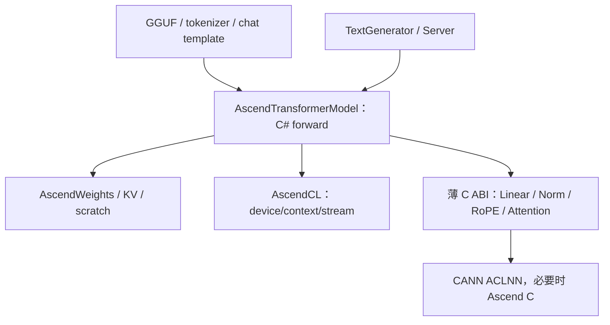

# DotLLM Ascend 接入：参考实现、测试环境与正确性验证

研究日期：2026-10-22；实机结果更新：2026-10-24。DotLLM 基线：`d88040451d7db56e5dfef9d5754ad0955b0f7fe5`。工作分支：`prepare/ascend-910b-bringup`。

> 完整实施结果（2026-10-24）：dense Llama/Qwen2 全模型、KV、CLI/API 已交付，910B4 套件 16/16 PASS、退出 0。默认 **FP32 权重/激活、FP16 KV/RoPE 表**；原 FP16 设想因全模型误差超限调整。最终证据及 CPU 对照见 [完整结果](ASCEND_FULL_RESULTS.md)，操作与范围见 [runtime](ASCEND_RUNTIME.md)。下文的资源/镜像调查是 2026-10-22 历史快照，算子候选与性能建议保留为研究背景。

## 1. 结论

最直接的实现参考是 **DotLLM 自己的 CUDA model + llama.cpp CANN 算子后端**。前者确定 C# forward、权重和生成器的接入方式，后者给出 Ascend tensor 描述、矩阵转置、RMSNorm、RoPE 和 attention 的实际调用。vLLM-Ascend 与本地 xLLM 则适合参照 attention metadata、分页 KV、graph 和生产调度，首版不需要移植它们的框架层。

环境已有一条经过历史实机验证的路径：公开可读镜像 `Ascend-cann-8.3.RC1_torch_npu_2.7.1_LlamaFactory`，VID `d6nakm3c77u7jl17ea90`，曾在目标组、目标队列的 Ascend910b4-64G 上成功执行 NPU Matmul 和两卡任务。本轮核实镜像状态仍为 OK，但当前 shell 没有 NPU，也没有可直接复用的活跃 Worker。目标保障队列当前 `total=16, used=16`；Spot 队列有卡余量返回，但 CPU/内存聚合余量为负，不能承诺即时调度。

建议实现独立 `DotLLM.Ascend`，首版使用 C# + AscendCL + ACLNN，FP32 展开权重、连续 FP16 KV；SmolLM-135M 与仓库已有 fixture 的 **Qwen2.5-0.5B-Instruct GGUF** 均已验证。正确性采用独立数学参考、DotLLM CPU、匹配 GGUF 权重的全模型参考三层证据；测试必须对齐最后一行 logits，避免沿用现有 CUDA diagnostic test 的行索引问题。

后续实施已新增实验性 Ascend runtime、FP16 Linear 原生桥接与独立 smoke。C# 编译和数学参考自测已通过；HJ 任务 `[internal resource ID]` 也已在真实 910B4 上完成 native 编译、链接和 C# 硬件 smoke：7 组 shape × 3 次输入，以及复制/生命周期检查全部通过，成功 trial `437423234`、Pod `5385230849` 退出 0。环境为 Debian 12、g++ 12.2.0、CANN/ops 8.3.RC1、.NET 10.0.0。最大 shape 级 normalized RMSE 为 `0.000222761212`，这是最初 M0 指标；后续全模型/其余基础算子已通过完整套件。详见 [进展证据](ASCEND_M0_RESULTS.md) 与 [复现说明](ASCEND_RUNTIME.md)。

## 2. 可以参照哪些对象

### 2.1 DotLLM CUDA：后端接入和 C# 编排

| 文件 / 方法 | 借鉴内容 | Ascend 必须重新实现的部分 |
| --- | --- | --- |
| `CudaTransformerModel.LoadFromGguf/Forward` | 复用 GGUF weight mapping，独立实现 `IModel`，预分配 scratch，embedding→attention→FFN→LM head 的顺序 | context/stream、ACLNN 调用、attention view、错误清理 |
| `CudaGemm.LinearF16` | 数学合约 `Y[M,N] = X[M,K] × W[N,K]^T` | CANN row-major view，不照搬 cuBLAS column-major 参数 |
| `CudaWeights`、`TransformerWeights` | Norm/bias、Q/K/V、gate/up/down、共享 embedding 与 output 的识别 | 默认分块展开为 FP32 上传，不复制 CUDA 压缩 GEMV 策略 |
| `CudaKvCache.UpdateDevice` | 每层 K/V 常驻、连续位置批量写入、rollback 保留内存 | 设备归属校验、ACL D2D/scatter、有效长度与错误状态 |
| `CudaDriverApi`、`CudaLibraryResolver` | `[LibraryImport]`、lazy resolver、opaque pointer、明确设备 | AscendCL 符号和自有 `.so`，不能依赖 CUDA DLL/PTX |
| `ServerStartup`、CLI run/chat | device 解析、专用 KV factory、加载时选择 model | 提前识别 `ascend[:index]`，绕开 `gpuLayers=0` 默认 CPU 分支 |
| `ServerState.ExecuteAsync/SwapModelAsync` | 现有请求串行 gate 和模型切换所有权 | context 在线程切换后重新设置、销毁前等待任务完成 |

上述代码已在固定基线本地读取。`IBackend` 仅有分配、复制与通信接口，计算入口是 `IModel`；新建内存 backend 不能独立完成接入。[cite:1]

### 2.2 llama.cpp CANN：最接近 DotLLM 的原生算子参考

本轮固定参考 commit：`d454a204ef2b63af357744809c05af897611a72e`。已下载并读取实际文件，不仅依据 README。

| 参考位置 | 已看到的实现 | 对 DotLLM 的价值 |
| --- | --- | --- |
| `ggml/src/ggml-cann/acl_tensor.h:108–135` | byte stride 除以元素字节数；构造 storage span；反转 ggml 维度后创建 ACL tensor | ACL stride 是元素单位；必须区分逻辑 shape、storage shape、offset |
| 同文件 `:169–200` | tensor list 接管内部 tensor 所有权，原 smart pointer `release()` | 桥接层避免 tensor 与 tensor list 双重释放；按实际 CANN 版本确认该规则 |
| `aclnn_ops.cpp:1311–1351`，`ggml_cann_rms_norm` | 调用 RmsNorm，构造 gamma 和 FP32 rstd 输出 | DotLLM 使用真实 norm weight 作为 gamma，不能照搬 ggml 的全 1 gamma |
| 同文件 `:2201–2250`，`ggml_cann_mat_mul_fp` | 用 shape/stride 表示权重转置，区分 Mm/BatchMatMul/Matmul，可选 NZ | 首版只取 ND 浮点路径；ND→NZ 转换和精度模式独立验证 |
| 同文件 `:2894–3268`，`ggml_cann_rope` | `aclnnRotaryPositionEmbedding`；NeoX mode=0、interleaved mode=1；F16→F32 临时转换；partial rotary tail 原样复制 | 比受 headDim=128 约束的旧 ApplyRotaryPosEmb 更合适的候选 |
| 同文件 `:3902–4176`，`ggml_cann_flash_attn_ext` | 调整 BSND view；Q 转 FP16；不对齐 D padding；传 KV head 数、mask、scale；调用 FusedInferAttentionScoreV2 | 直接参考融合 attention 的准备过程，保留原始 D 的缩放因子 |
| `ggml/src/ggml-cann/CMakeLists.txt` | Linux x64/arm64，CANN include/lib 搜索；链接 ascendcl、nnopbase、opapi、acl_op_compiler | 明确开发镜像必须有 toolkit headers；DotLLM 的最小库按实际使用裁剪 |

ggml tensor 的维度顺序和 DotLLM 不同。**不能复制其 `std::reverse(shape/stride)` 到 DotLLM**；应直接为 DotLLM row-major shape 构造正确的 ACL descriptor。

该版本源码包含更新的算子、graph 与模型支持，不能据此认定它整体能编译于 CANN 8.3.RC1。首版只借鉴所需算子的实现方法，在目标镜像逐一核实头文件和导出符号；若融合接口不匹配，使用已经验证的基础算子路径。[cite:2]

### 2.3 vLLM-Ascend：attention/KV metadata 与后续批处理

本轮固定参考 commit：`87f2b060adff3079bd63f995c6c628820fec0f9d`，已读取：

- `vllm_ascend/attention/attention_v1.py`：`AscendMetadata` 分别保存实际 query 长度、KV 长度、block tables、slot mapping；`full_graph_fia/full_graph_fia_v2` 传这些信息给融合 attention。query 的累计边界与 KV 的实际长度不是同一个字段。
- `vllm_ascend/ops/rotary_embedding.py`：`rope_forward_oot`、`AscendRotaryEmbedding.forward_oot` 区分 full/partial rotary、half/interleaved，并按硬件/执行能力选择算子。

首版从中借鉴 **数据语义与边界条件**：prefix 长度、query offset、GQA head 数、实际有效 token 数、padding。后续接 `#256` Continuous Batching 时再增加 slot/block mapping。torch_npu、vLLM 的注册器和 graph task 管理不进入 DotLLM runtime。

vLLM-Ascend 和 llama.cpp CANN 都调用 CANN，二者输出一致只能加强集成证据，不能成为独立数学正确性的唯一依据。[cite:3]

### 2.4 本地 xLLM：可就地读的 NPU attention/RoPE

已读本地参考：

- `xllm/backend/inferencer/torch/layers/xpu/attention.py:140–191`：prefill fallback 调用 `npu_fusion_attention`、TND layout 和累计 sequence lengths，代码明确标注该 fallback 不支持 chunked prefill。
- 同文件 `:256–312`：decode 使用 BNSD、block table 和实际 KV 长度，也区分 graph capture 的执行分支。
- `xllm/backend/inferencer/torch/layers/xpu/rotary_embedding.py:140–175`：cos/sin 按 positions 取 slice，Q/K reshape 为 `[1,T,H,D]`，再执行 rotary。

用途是核对生产数据如何准备，尤其是 **普通 prefill 与追加 chunk 不能使用相同的默认 mask/offset**。不把本地 xLLM 代码复制进公开 DotLLM；公开贡献以公开参考和自有实现为依据。

## 3. 应如何实现 Ascend 接入

### 3.1 C# 与 CANN 的边界



ACLNN 本身是 C API，也可以全部直接用 `[LibraryImport]`。推荐首版通过薄 C++ 桥接库封装复杂算子，因为目标 toolkit 头文件能检查 64 位参数、tensor list、可选 tensor 和执行器类型；C++ RAII 处理描述对象，C# 保留模型编排。两种方式都无需 Python。

桥接库不能变成另一个完整 inference engine。推荐导出 `dotllm_ascend_linear_f16`、`dotllm_ascend_rmsnorm`、`dotllm_ascend_rope`、`dotllm_ascend_attention` 等算子入口，输入为 device pointer、明确 shape/stride、参数、stream/context。自有 opaque context 负责 workspace 与错误信息；CANN 的执行器不跨入 managed 代码。

接口规则：

- C ABI 固定宽度整数；`int64_t` 对应 C# `long`，`uint64_t` 对应 `ulong`，pointer 用 `nint`。不跨边界传 STL/C++ 类。
- 明确导出 ABI 版本；C# 启动检查 native ABI 与 required symbols。
- 所有 C++ 异常在边界内捕获，返回状态码和可读取的错误文本。
- 对可能执行较久的 ACLNN 规划、同步、分配不加 `[SuppressGCTransition]`。
- AscendCL runtime/context 可以直接绑定，也可进入桥接；必须只存在一个明确的全局初始化/finalize owner。
- 稳定 tensor metadata 可复用，但不能默认 executor 可按 shape 重复调用。workspace 不得提前释放；buffer 扩容必须等待旧任务完成。

### 3.2 接入生成器时需修正的约定

当前 `TextGenerator` 在 prefill/decode 都传 `deviceId:-1`，CUDA model 使用自己绑定的 context 执行并返回 CPU tensor。首版建议保持这一行为兼容：**计算设备由 `AscendTransformerModel` 加载时绑定，`Forward(...,-1)` 使用该设备并返回 host logits**；显式传入非负 ID 时要求与绑定 ID 一致，不允许临时跨设备执行。该约定写入后端文档和测试，不误把 `-1` 当成强制 CPU 计算。

`AscendBackend.AllocateOnDevice/CopyBetweenDevices` 仍严格检查 NPU ordinal、tensor 类型和 context。`AscendTensor` 只能表示设备内存；最终 logits 使用 `UnmanagedTensor`，`DeviceId=-1`。[cite:1]

主线 CPU model 返回 `[T,V]` 全位置 logits，CUDA 返回 `[1,V]` 最后位置。初版 Ascend 可使用 CUDA 的最后位置合约，因为生成器会按 `Shape[0]-1` 取行；speculative 尚未支持时显式拒绝。新对照测试必须分别取每个 tensor 的最后一行，不能假设 CPU 和 NPU rows 一样。

prefix cache 也有后端耦合：`TextGenerator.ResolveKvCache` 仅对 `SimpleKvCache/PagedKvCache` 截断复用。首版 Ascend 在创建 `TextGenerator` 时令 prefix cache 为 null；不要仅注册 KV factory 就宣称 prefix reuse 可用。第二阶段再用通用 rollback 能力接入。

### 3.3 权重、布局和具体算子

首条真实模型路径建议直接使用仓库现有 `SmolLM-135M.Q8_0.gguf`，**加载时 CPU dequant→FP32，一次上传**。这样可以固定同一 GGUF 和 tokenizer，避免另找 F16 artifact。先让 F16/F32 与 Q8_0 展开路径通过逐权重抽样验证；所有设备 GEMM 仍为浮点，不能把它宣称为 NPU Q8 量化加速。

`TransformerWeights` 的 projection/bias/tied-output 信息可通过新增 `InternalsVisibleTo("DotLLM.Ascend")` 复用，首版不创建 CPU model 或触发 R4 repacking。加载时先核实所有必要 tensor、dtype、shape，再分配设备内存。

关键布局：

| 操作 | DotLLM 逻辑布局 / 实现 |
| --- | --- |
| Embedding | 权重 `[V,H]`，indices 为实际 API 支持的整数类型，输出 `[T,H]` |
| Linear | X `[T,K]` stride `[K,1]`；原始 W `[N,K]`；W 转置 view `[K,N]` stride `[1,K]`；输出 `[T,N]` |
| RMSNorm | 按 H 归一化，真实 gamma `[H]`，额外 rstd 为 FP32；eps 从 GGUF config 获取 |
| SwiGLU | `SiLU(gate) × up`；先两算子，融合后与拆分结果比较 |
| Q / K / V | `[1,T,Hq,D]` / `[1,T,Hkv,D]` / `[1,T,Hkv,D]`，按选定 attention layout 建立 view |
| RoPE | 从 GGUF `RoPEType` 获取 Norm/NeoX；优先核实 `RotaryPositionEmbedding`，部分维度 tail 不旋转 |
| KV | 每层 K/V `[capacity,Hkv×D]`；位置连续时写入指定 offset，读时只覆盖有效长度 |
| Attention | 基础 FP32 score/softmax/PV 先作 NPU 语义对照；再启用验证通过的融合接口 |
| Logits | 最后位置 norm/LM head，cast 到 FP32，等待 stream 完成，D2H 返回 `[1,V]` |

初版 Linear 使用 ND descriptor。不能只把 format 改为 NZ 而不做真实 packing；不能复制 llama.cpp 的精度降级模式并假定等价。FP16 输入的实际累加精度需单独记录，RMSNorm/softmax 优先保持 FP32 统计。

RoPE 首选候选为 `aclnnRotaryPositionEmbedding`，fallback 为基础算子，确认缺口后才写 Ascend C。旧版 `aclnnApplyRotaryPosEmb` 的 headDim=128 限制并不意味着所有 CANN rotary 接口都限制为 128。

融合 attention 可以优先核实 `aclnnFusedInferAttentionScoreV2` 是否在 8.3.RC1 中存在并支持所需 layout。若不可用，再核实 Prompt/FlashAttentionScore 与 IncreFlashAttention 的版本匹配路径。不要盲目调用最新 vLLM-Ascend 的全部接口。

### 3.4 attention/KV 需要维持的数学条件

对于本轮 query position `p_i`，KV 的 position `j` 只有在 `j <= p_i` 时可见。完整 prefill 的 `p_i=i`；已有长度 `P` 后追加 T 个 query 时 `p_i=P+i`。错误使用 T×T 的默认三角 mask 会漏掉 prefix，或让 query 看见未来位置。

GQA 映射必须满足 `Hq % Hkv == 0`，query head `h` 使用 KV head `h / (Hq/Hkv)`。融合接口显式传两个 head 数；基础参考也用这个映射。

长度状态在一次 forward 完整成功后提交，失败后不能把半完成 KV 当成有效 cache。各 layer 的写入与有效长度一致；rollback 后旧 tail 内存可以保留，但不进入 attention。首版不接受未填充位置间的空洞，直到稀疏/离散更新路径验证通过。

如果 D padding 到硬件对齐值，用原始 D 的 `1/sqrt(D)` 缩放；padding 元素为 0，输出只保留原始维度。view 与 transpose 不是同义词：不支持 stride 的算子需要显式转换并计量成本。

## 4. 是否有可测试运行的环境

### 4.1 当前 shell：可开发 C#，不能运行 NPU

本轮直接检查结果：

| 项目 | 结果 |
| --- | --- |
| 实例 | `[internal resource]`，名称 `vayne`，owner `[internal resource]`，running |
| Master 集群 | `[internal resource]`，不是目标 Arnold `[internal resource]` |
| CPU / 内存 | 8 核 / 32 GiB |
| .NET SDK | 10.0.100 |
| 架构 | x86_64 |
| `mlx worker list` / instance worker count | 均为 0 |
| `/dev/davinci*` | 无 |
| `/usr/local/bin/npu-smi` | 0 字节文件；执行无输出 |
| torch_npu | 当前 Python 找不到模块 |
| 我的 Devbox 2.0 | `control-plane=cn` 自有实例查询返回空 |
| 我的目标保障队列 running/staging job | 指定账号、组、队列 filter 查询返回空 |

这些结果仅覆盖当前 shell 与查询 filter，不能推出全组没有 NPU 任务。Master 的环境与目标 worker 不同，不能通过在 Master 安装 torch_npu 得到 NPU。

本地已经恢复 .NET 包并构建到测试程序集。执行选择的 `RoPETests/RmsNormTests/AttentionTests/MatMulTests`，VSTest 报告 **106 passed、0 failed、0 skipped**，耗时 674 ms。`CreateAppHost` 初次构建受沙箱限制，用 `-p:UseAppHost=false` 后测试执行完成；外层工具仍因 memfd/SDK metadata 访问限制返回 1。因此这是一份成功的测试器结果，附带工具级沙箱异常，不能写成命令零退出通过。

使用的测试命令：

```bash
dotnet test tests/DotLLM.Tests.Unit/DotLLM.Tests.Unit.csproj -c Release \
  --filter 'FullyQualifiedName~RoPETests|FullyQualifiedName~RmsNormTests|FullyQualifiedName~AttentionTests|FullyQualifiedName~MatMulTests' \
  --artifacts-path /tmp/dotllm-ascend-research/dotnet-artifacts \
  -p:UseAppHost=false -p:NuGetAudit=false
```

### 4.2 已有经过 NPU 验证的镜像

本轮平台查询：

| 字段 | 结果 |
| --- | --- |
| Image | `Ascend-cann-8.3.RC1_torch_npu_2.7.1_LlamaFactory` |
| Image SID | `d6n3lorc77u49f25nd40` |
| VID | `d6nakm3c77u7jl17ea90` |
| 镜像 URL | `[internal endpoint]` |
| 权限 / 公开 | `read` / true |
| region 构建状态 | `China-North-LF: OK` |
| Vayne 曾固定的 digest | `sha256:e221a33873738a8cf5a0447754073c1fb30ff9548abb63cc581754900e8eaeb2`；来自历史 manifest，本轮未重查 registry digest |

历史成功任务经本轮 `runs get` 再确认：

- run `[internal resource ID]`，`status=done`，trial `430102981`；
- group `2079`，cluster `20`，队列 `[internal resource]
- 一个 worker，2 张 `ASCEND910B4_64G`，24 CPU、128 GiB，使用上述 VID；
- 本地归档的 pod exit evidence 为 0，已完成比较任务；
- 2026-10-12 和 2026-10-15 的 runtime preflight 记录 x86_64、CANN **8.3.RC1**、driver **25.5.0**、torch/torch_npu **2.7.1**、逻辑 NPU 两张、设备 `Ascend910B4-1`；
- 归档 BF16 Matmul 相对 CPU FP32 的 L2 误差为 `0.002869458170607686`，实际在 `npu:0` 执行。

这证明硬件、镜像和历史任务路径可行，不证明新的 C# ACLNN bridge 已经通过。Python/NPU 预检需要保留作为环境对照，再增加 C++ ACL 与 C# P/Invoke 的执行验证。

### 4.3 当前卡资源

本轮 `control-plane=cn` 当前态：

| 队列 | 型号 | 返回的卡字段 | 其他情况 |
| --- | --- | --- | --- |
| [internal resource] 组保障 Ascend 队列 | Ascend910b4-64G | total=16、used=16、allocatable=16 | allocatable 是聚合容量字段，不能视为空闲；可用队列列表未返回该行 |
| [internal resource]，SID 54 | 同型号 | rest_gpu=20 | rest_cpu=-53，rest_memory=-219392 |
| [internal resource]，SID 64 | 同型号 | rest_gpu=192 | rest_cpu=-194，rest_memory=-1214464 |

Spot 行来自 `my-group-resources`，`mlx worker quota` 同样返回 20/192 张。数值会变化，负的 CPU/内存显示当前聚合数据不能直接转为可调度承诺。查询能看到候选不代表能成功启动 Worker，也不能推断 [internal resource] Master 可跨到目标队列。

### 4.4 推荐的运行路径

优先使用 **显式指定 VID 的短时单 worker Merlin Job**，独立于现有 CPU Master 镜像。历史两卡 job 证明可用路径；新任务申请单卡用于 smoke，具体 CPU/内存规格与队列由当前平台预检确定。保障队列无已确认余量时，可评估 Spot 做可重跑 smoke；长时间 benchmark 尽量使用稳定资源。

DotLLM 运行只要求匹配 CANN + .NET；Python 依赖仅用于验证参考。先核实已有镜像是否具备 `acl/acl.h`、`aclnnop/*.h`、`libascendcl.so/libopapi.so/libnnopbase.so`、CMake、g++。缺少 .NET 时可打包框架依赖 DLL 并提供匹配 runtime，或发布 self-contained Linux x64 CLI；native bridge 必须在兼容 OS/glibc/CANN 环境中编译。

已查 `mlx worker launch --help` 中 `--image` 描述为 **ray job 的 image override**，不能据此断言普通 Worker 支持任意训练镜像。需要交互开发时另行核实 Worker 的镜像与 Master/队列兼容性，不能直接沿用普通 launch 默认镜像。

新运行前依次验证：

1. 当前队列与资源规格、镜像权限与版本；最终 payload 通过 `job-v2 check-items check`，不能以 dry-run 当作服务端调度验证。
2. pod 运行后核实真实设备节点、逻辑 ordinal、CANN/driver、headers/libs 和 .NET。
3. 独立 C++ FP16 ACL Matmul 通过，再运行调用自有 bridge 的 C# 同输入 Matmul。
4. bridge 算子集通过后再跑全模型；输出代码/模型 SHA、dtype、实际符号、误差和设备同步计时。
5. task 结束后检查 pod exit code 和测试 summary，硬件测试零执行/全部 skip 判为未验收。

2026-10-22 初次研究仅做只读查询；后续已创建自有单卡验证任务并执行 C#/C++ 全模型验收，证据见完整结果。

## 5. 如何验证正确性

### 5.1 三种参考要各自解决一个问题

| 参考 | 解决的问题 | 局限 |
| --- | --- | --- |
| 独立 CPU FP32/FP64 数学实现 | Linear、Norm、RoPE、mask、GQA 的数学语义 | 不直接验证模型转换/词表 |
| DotLLM CPU，用同一 GGUF | Ascend 接入是否保持 DotLLM 的模型/权重语义 | CPU 本身可能有错误；Q8 计算近似与默认 FP32 展开有精度差异 |
| 匹配权重的 llama.cpp CPU / HF math reference | 独立引擎和全模型语义、tokenizer、最后位置 logits | HF 原始权重不等于量化 GGUF；必须对齐权重与坐标排列 |

torch_npu 与自有 bridge 的同输入比较用于核实 C ABI/layout；两者共享 CANN，不能替代独立的 CPU 数学实现。

特别是 Llama GGUF Q/K 可能已经做 RoPE 配对相关排列，而 HF 模型使用原来的 split-half 顺序。对照 HF 时必须使用与 GGUF 对应的还原/排列规则并抽样核实，不能只比较同名 weight。Q8_0 权重与原始 HF BF16/FP16 也有量化误差；若要独立模型数值金标准，使用未量化固定 artifact，或者把同一 GGUF 解码后的权重导入数学参考。

### 5.2 分层验证矩阵

| 层级 | 最小测试 | 必须断言 |
| --- | --- | --- |
| L0 Runtime | C++ ACL 与 C# bridge 的相同 FP16 Matmul；H2D/D2H；失败清理 | 真正设备执行、有限值、shape/bytes、一致误差范围、正确 context |
| L1 算子 | 非对称 Linear；Norm 的非 1 gamma；SwiGLU gate/up；RoPE 两模式；GQA/causal attention | 不仅随机大矩阵；解析可知用例与随机 seeded case 都通过 |
| L2 单层 | 固定输入、真实 layer 权重，逐点抓取 norm/Q/K/RoPE/attn/FFN/residual | 找到最早误差超限点；descriptor/transpose 与权重排列正确 |
| L3 全模型 | 同一 tokens/positions，prefill 后 teacher-forced 32–128 步 | 每一步相同输入，正确最后 logits 行，全 vocab 数值与 top-k 指标 |
| L4 KV 状态 | 完整重算 vs cached decode；分段 prefill；rollback；A/B 请求隔离 | 未用 cache tail 不可见，position offset 正确，重复使用不污染 |
| L5 API | CLI run/chat、SSE、cancel、EOS、两次请求、卸载/重载 | 设备确实为 Ascend、输出与 usage 合约、取消不提前释放异步 buffer |

L1 的可解释测试建议：

- Linear：令 K 与 N 不同且权重非对称，验证 `X × W^T`；增加带 stride 的转置 view。方阵、常数矩阵很容易掩盖错误转置。
- Norm：gamma 不全为 1，输入含大小值，验证 eps；rstd 与输出分别核验。
- RoPE：position=0 应恒等；position=1/127/511；D=64/128；rotaryDim<D 时 tail 位级不变；Norm 与 NeoX 使用各自显式数学公式。
- Attention：Q/K 全 0 时概率均匀，结果应为每个 query 可见 V 的均值；各 KV head 取不同值，验证 GQA 映射。
- Causality：未来 V/K 填入很大的 sentinel，结果仍只取可见历史；追加 query 时验证 P+i 的 mask。
- KV：写入后 D2H 抽样核对地址和内容；不同 layer/token/head 的值各不相同，避免全 0 数据通过错误 stride。

### 5.3 明确最后 logits 的行

当前 CPU model 在 `TransformerModel.cs:410–427` 返回 `[T,V]`，CUDA 在 `CudaTransformerModel.cs:289–309` 返回 `[1,V]`。已有 `CudaLogitComparisonTest.cs:58–65,97–100` 从 CPU 的第 0 行读取，且主要打印误差；这个测试思路可借鉴，代码不能原样作为验收标准。[cite:1]

正确的比较逻辑分别计算：

```text
CPU last row = cpu.DataPointer + (cpu.Shape[0] - 1) × V × sizeof(float)
NPU last row = npu.DataPointer + (npu.Shape[0] - 1) × V × sizeof(float)
```

prefill 后固定下一 token；之后两端都输入同一个 token 和 position。不得让 CPU/NPU 各自 greedy 采样再用不同输入比较 logits。全模型初版只有最后输出时，可通过各 prefix 的完整重算取得逐位置参考。

### 5.4 误差、门槛与错误定位

同时输出并断言 finite、max abs、mean abs、relative L2、cosine similarity、top-k overlap。top-1 margin 很小的 token 不强制 greedy 一致，但不能放宽全 vocab 数值比较。

基础算子使用 `abs(actual-reference) <= atol + rtol*abs(reference)`；near-zero 数据同时检查绝对误差。公式：

```text
relative_L2 = norm(actual - reference) / max(norm(reference), epsilon)
```

阈值区分以下来源，不在失败后随意放大：

1. 相同 FP16 输入的 NPU vs FP32 math：测计算精度。
2. Q8_0 解码→F16 的权重与原始 CPU Q8 GEMM：测展开/舍入与 CPU activation quant 的差异。
3. 全模型多层累计误差：独立预算，不使用通用的 `1e-2` 掩盖累积偏差。

用固定 calibration cases 确定算子级精度范围并固定阈值，保留未参与 calibration 的 cases 验收。最小解析用例使用解析值对应的紧阈值；全模型采用预先冻结的独立 RMS/max/cosine 预算。最终全模型误差门槛与实测数据见完整结果；不沿用初次 M0 的覆盖范围。

首版保存逐层 tensor 抓取的 debug 开关。只有 debug 验证允许层间 D2H；正常生成保持激活/KV 常驻设备。误差异常时定位顺序为 **权重 upload→矩阵转置→norm→RoPE→KV→mask/GQA→输出行**，避免只看最终文字是否通顺。

### 5.5 模型和任务验收

优先模型 artifact：

- `QuantFactory/SmolLM-135M-GGUF/SmolLM-135M.Q8_0.gguf`：仓库 `SmallModelFixture` 已定义。
- `Qwen/Qwen2.5-0.5B-Instruct-GGUF/qwen2.5-0.5b-instruct-q8_0.gguf`：`QwenModelFixture` 已定义，覆盖 tied embedding、Q/K bias 和 NeoX。
- 后续增加 D=128 的 dense 模型及更长序列；Qwen3 QK norm 单独验收。

初次研究未找到本地 GGUF；后续已下载并固定 SHA256，见完整结果。测试下载通过 `DOTLLM_TEST_CACHE_DIR` 指向 repo 外缓存，正式硬件任务尽量预放模型，避免下载过程占用卡。

最小提交证据为：环境 manifest、模型与代码 hash、required symbol/ABI 检查、逐算子/逐层 summary、teacher-forced logits 统计、KV equivalence、API/SSE case、pod exit 和测试执行数量。perf warmup 与 correctness 分开；设备同步后的耗时才用于报告 tok/s。

## 6. 优先执行顺序

1. 用既有可读 VID 准备单卡 smoke 运行，核实 8.3.RC1 的 headers/libs 和候选 rotary/attention 符号；确认 C++ ACL 与 C# 计算链路。
2. 完成 runtime/tensor/context/stream、FP32 weight upload 和 ND Linear；同时写非对称矩阵和生命周期测试。
3. 实现 Norm/SwiGLU/通用 RoPE/基础 attention，逐算子、单层对照。
4. 实现 `AscendTransformerModel` 与连续 KV，teacher-forced 多步 logits 和缓存/重算等价。
5. 接入 CLI/Server，明确 `Forward(-1)` 兼容、最后一行 logits、禁用未支持的 prefix/speculative。
6. 通过小模型后启用已验证融合算子，再以独立 issue 扩展分页、批处理、graph/NZ/量化。

实施已完成至两真实模型、KV、CLI/API；完整 16 阶段 PASS。当前后续范围是性能 profile、受测融合/低精度快路径、分页/批处理；短时 unload 与合成 fault 验收不代表长期无泄漏或物理设备恢复。独立 firmware 版本仍为 NA，其他未测边界见完整结果。

## 7. 来源与请求证据

- [cite:1] 固定 DotLLM 主线源码：[CUDA model](https://github.com/kkokosa/dotLLM/blob/d88040451d7db56e5dfef9d5754ad0955b0f7fe5/src/DotLLM.Cuda/CudaTransformerModel.cs)、[CPU model](https://github.com/kkokosa/dotLLM/blob/d88040451d7db56e5dfef9d5754ad0955b0f7fe5/src/DotLLM.Models/Architectures/TransformerModel.cs)、[TextGenerator](https://github.com/kkokosa/dotLLM/blob/d88040451d7db56e5dfef9d5754ad0955b0f7fe5/src/DotLLM.Engine/TextGenerator.cs)、[CUDA diagnostic test](https://github.com/kkokosa/dotLLM/blob/d88040451d7db56e5dfef9d5754ad0955b0f7fe5/tests/DotLLM.Tests.Unit/Cuda/CudaLogitComparisonTest.cs)。本地已读取。
- [cite:2] 固定 llama.cpp CANN 源码：[算子实现](https://github.com/ggml-org/llama.cpp/blob/d454a204ef2b63af357744809c05af897611a72e/ggml/src/ggml-cann/aclnn_ops.cpp)、[ACL tensor](https://github.com/ggml-org/llama.cpp/blob/d454a204ef2b63af357744809c05af897611a72e/ggml/src/ggml-cann/acl_tensor.h)、[构建](https://github.com/ggml-org/llama.cpp/blob/d454a204ef2b63af357744809c05af897611a72e/ggml/src/ggml-cann/CMakeLists.txt)。本轮下载读取，算子源码两次取到的内容 hash 相同。
- [cite:3] 固定 vLLM-Ascend 源码：[attention](https://github.com/vllm-project/vllm-ascend/blob/87f2b060adff3079bd63f995c6c628820fec0f9d/vllm_ascend/attention/attention_v1.py)、[RoPE](https://github.com/vllm-project/vllm-ascend/blob/87f2b060adff3079bd63f995c6c628820fec0f9d/vllm_ascend/ops/rotary_embedding.py)。本轮下载读取。
- 本地 xLLM：`[workspace path]`。
- 历史镜像 manifest：`[workspace path]`；runtime preflight：`[workspace path]`；pod exit：同级 `npu_terminal_evidence.json`；2026-10-15 对照归档：`Vayne/research/ascend_910b_optimized_evidence_20261015/final/raw/runtime_preflight.log`。

当前态查询全部使用 `--control-plane cn`，成功响应 code=0：

| 查询 | request ID |
| --- | --- |
| cpu-devbox get `[internal resource]` | `20261022021128EB45C17BBF245ED5B69E` |
| gpu-devbox 自有 list，page_size=30，返回空 | `202610220211275732EFFF396426C332BB` |
| image-versions list，filter.vid 指定 VID | `202610220211513D6DC11273B77083DD40` |
| image get `d6n3lorc77u49f25nd40`，read 权限 | `20261022021934D754E867EBE4DE3CE5ED` |
| 历史 job runs get `[internal resource ID]` | `20261022021209BD966787128CE631C296` |
| 当前目标组 groups get include_resources | `20261022021236B97E7649C1F8AC2BF029` |
| my-group-resources filter.group_sid=2079，gpu_type=Ascend910b4-64G | `202610220212100793B75861D3DBD90F2D` |
| 本人/组/目标保障队列 running/staging list，返回空 | `20261022021207044EAE898E20A3241119` |

这些聚合查询不提供占用归因或排队 ETA；镜像 OK 只表示构建状态。
自有 bridge 的本轮 runtime/Linear 实机日志、数值统计与校验和已记录在
[M0 结果](ASCEND_M0_RESULTS.md)；后续基础算子、全模型精度、KV/API 与性能记录见 [完整结果](ASCEND_FULL_RESULTS.md)。
