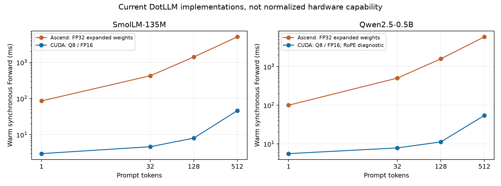
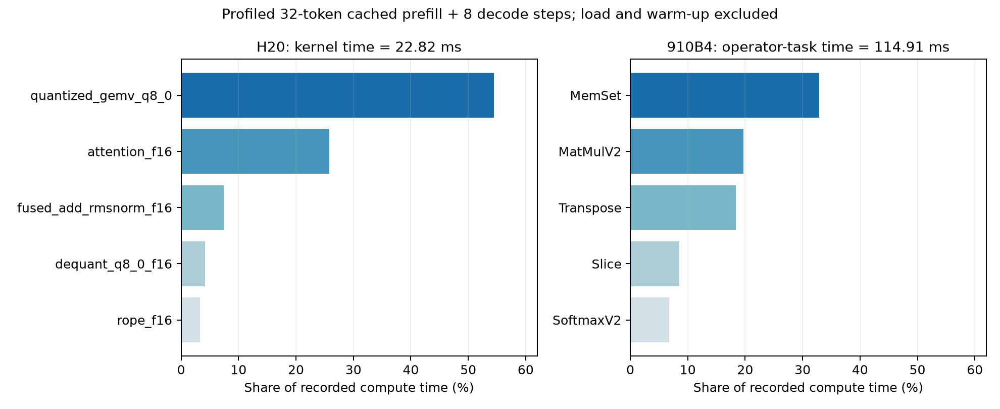

# DotLLM：Qwen3.6 适配评估、Ascend/CUDA 实测与 profiling

证据日期：2026-10-24。受测推理实现 commit：`93010f3e6208a58fdeb27c174b0ca6d2f876250e`。代码与实验材料分支分别为 [ascend/910b4-dense-baseline](https://github.com/Cheongroach/dotLLM/tree/ascend/910b4-dense-baseline)、[archive/ascend-research-20261024](https://github.com/Cheongroach/dotLLM/tree/archive/ascend-research-20261024)。归档中的 [followup](../followup/) 提供机读结果、公开 timing trace、来源与复现说明。

**当前版本不直接支持 Qwen3.6。** 现有 Ascend 后端适合做单卡 dense Llama/Qwen2 的正确性基线；迁移 Qwen3.6-27B 需要新增混合 attention 架构和递归状态缓存，且目前 FP32 权重策略超过单张 64 GiB NPU 的容量。若目标是尽快部署真实 Qwen3.6，优先使用官方已有支持的 vLLM-Ascend；若目标是贡献 DotLLM 核心能力，则先实现 text-only Gated DeltaNet，再考虑 MoE、视觉、MTP 与服务调度。

两个设备均已执行同 GGUF 的 CLI benchmark、固定 token 数值比较与实际 profiling（CUDA Nsight Systems、NPU msprof）。本次 SmolLM CUDA decode 中位数为 **275.10 tok/s**，910B4 重测为 **10.16 tok/s**。这是当前软件实现、精度与不同 worker 的比较，不能解释为 H20 的硬件性能是 910B4 的 27.1 倍。Qwen CUDA 基线存在 RoPE 映射错误，不能用其吞吐宣称正确推理性能；独立参数覆盖实验验证了错误原因。

## 1. Qwen3.6 的实际架构与支持边界

这里的 “Qwen3.6+” 区分开源 checkpoint 和 API 产品。官方 [Qwen3.6-27B 配置][config27]、[35B-A3B 配置][config35] 与 [发布说明][blog] 是判断依据；后续型号必须重新检查 config，不能由版本名推断兼容。

| 对象 | 官方形态 | 对 DotLLM 的意义 |
| --- | --- | --- |
| Qwen3.6-27B | 开放权重；dense FFN；GDN/full attention 混合；多模态 | 无 MoE 路由仍不等于普通 Qwen2 Transformer；需要新架构 |
| Qwen3.6-35B-A3B | 开放权重；混合 attention + MoE | 在 GDN 基础上新增 router、专家执行和共享专家；3B active 不等于只装载 3B 权重 |
| Qwen3.6-Plus / Max-Preview | 发布说明中的 API 产品 | 可通过 API 接入应用；未在本次来源中取得可供 DotLLM 加载的公开权重 |
| 此后的 “+” 型号 | 未由本次实验覆盖 | 按配置与 checkpoint 单独适配、验证，不承诺家族通用支持 |

27B 的 text config：

| 维度 | 值 | 容易错误的现有假设 |
| --- | --- | --- |
| 层与 FFN | 64 层；hidden 5120；intermediate 17408 | 每层不能统一构造 Q/K/V + full attention |
| 层类型 | 48 GDN + 16 full attention，周期为 3 linear + 1 full | 普通 KV cache 不足以表示完整模型状态 |
| Full attention | 24 Q heads、4 KV heads、head dim 256 | `24×256=6144 ≠ hidden 5120`；不能用 hidden 作为 Q/attention output 宽度 |
| Q 投影 | Q 与 gate 合并投影，输出宽度 `2×6144=12288` | 拆分必须按每 head 的 Q/gate 布局，与独立 golden 对齐 |
| 位置编码 | rotary factor .25，即 rotary dim 64；theta 10,000,000；mRoPE sections [11,11,10] | text-only 仍需核对其实际 position/layout；视觉路径额外处理多轴位置 |
| GDN | key heads 16、value heads 48；K/V head dim 128；causal depthwise conv kernel 4 | 需要分组 head 映射、卷积历史与递归矩阵状态 |
| 精度与词表 | checkpoint BF16；SSM state FP32；vocab 248320；untied LM head | 不能直接把 BF16 当作 F16 位模式加载；大词表投影也有成本 |
| 最大上下文 | 262144 | 是模型能力上限，不能当作单卡可分配的缓存预算 |
| 其他 | 视觉 config；一个 MTP hidden layer | text-only 适配不覆盖视觉或 speculative decoding |

官方 config 的 `architectures` 仍为 `Qwen3_5ForConditionalGeneration`、`model_type=qwen3_5`。应按实际结构复用 Qwen3.5/3.6 混合算子实现，不应只注册一个 `Qwen3.6` 字符串。

35B-A3B 的关键差别是 hidden 2048、40 层、16 Q / 2 KV heads、head dim 256，GDN K/V heads 16/32、head dim 128，以及 256 个 routed experts、每 token top-8、shared expert intermediate 512。[config35] 因此 27B 的具体 tensor shape 不能原样复用。

## 2. 如何适配：实现入口、状态合约和验收顺序

当前代码入口分别为 `Core/Models/ModelConfig.cs`、`Models/Gguf/GgufModelConfigExtractor.cs`、`Ascend/AscendWeights.cs`、`Ascend/AscendTransformerModel.cs`、`Ascend/AscendForwardState.cs`、`Ascend/AscendKvCache.cs` 与 `native/ascend/`。当前 Ascend 在加载前严格校验支持配置，这个能力边界应继续保留。

| 改造 | 实现要求 | 最早验收点 |
| --- | --- | --- |
| 架构配置与加载 | 增加每层类型、独立 Q/K/V 尺寸、linear attention 配置；建立 safetensors loader 或经验证的 GGUF tensor 映射 | missing tensor/dtype/shape 在设备初始化前失败；每权重映射逐项检查 |
| Full attention | head-wise Q/K norm、partial/mRoPE、Q/gate 拆分、attention 输出 sigmoid gate、`6144→5120` 输出投影 | tiny FP32 单层对照；prefill 与一步 decode 相同 token |
| Norm 与 FFN | 普通 Qwen3.5 norm 是 `(1+weight)×RMSNorm(x)`；GDN 的 gated norm 是 norm 后乘 SiLU(z) | 不能把两种 norm 的权重约定混为一体；覆盖 norm-before-gate 次序 |
| GDN 输入 | Q/K/V、z、a、b 投影；depthwise causal conv；SiLU；Q/K L2 norm；key head 到 value head 分组映射 | one-shot/split causal conv、1-token、padding、缓存边界 |
| GDN 计算 | 先 FP32 recurrent reference，再 chunked prefill 与融合 decode | 单层多步、长序列漂移、chunk 边界、不同 batch 独立状态 |
| Hybrid cache | 16 层 full-attention KV；48 层 conv/recurrent state；统一 append/reset/fault/dispose 合约 | split 与完整重算一致；rollback 后重放；跨请求隔离 |
| 权重常驻 | BF16 或实际量化计算路径；载入阶段避免整模型 FP32 复制峰值 | 冻结数值预算通过；真实设备 peak，而非 tracked buffer 相加 |
| 产品与后续 | tokenizer/chat template、thinking/tool parser；MoE、vision、MTP、分页、batching 分阶段 | 独立标记支持范围；HTTP/SSE 通过不能替代架构精度通过 |

GDN 的最小可验证 recurrence，令 `S∈R^(Dk×Dv)`：

```text
q = L2Norm(q_raw) / sqrt(Dk)
k = L2Norm(k_raw)
beta = sigmoid(b)
g = -exp(A_log) * softplus(a + dt_bias)
S_bar = exp(g) * S
delta = beta * (v - k^T * S_bar)
S_new = S_bar + k * delta^T
y = q^T * S_new
output = out_proj(RMSNorm(y) * SiLU(z))
```

公式来自 Transformers [Qwen3.5 实现][modeling] 的 recurrent 与 gated norm 路径，实际布局、广播、q scaling 和 epsilon 以固定源码版本的 golden 为准。BF16 activation 不改变 FP32 recurrent state 的必要性。

**Rollback 不能只减 `CurrentLength`。** full-attention KV 可以逻辑截断，但 GDN 已经把过去 token 累积进 `S` 和 conv history。应先用状态 snapshot + replay 实现正确性，再按 speculative block 长度优化快照；prefix sharing 也必须保存匹配位置的 hybrid state。当前 `IKvCache` 的类型与命名可以兼容包装，但其生命周期合约需要覆盖所有这些状态。

建议贡献顺序：tiny FP32 CPU reference → 单层 NPU GDN recurrent/conv → text-only hybrid 小模型与整模型 → BF16/量化权重 → chunk/fusion/graph → MoE/vision/MTP。当前“小模型能跑”到 27B 上线之间，架构与权重容量是两个独立门槛。

## 3. 单卡容量：为什么当前 FP32 路径不适合 27B

仅按标称参数数估算，不包含视觉、MTP、tensor 元数据、runtime workspace、加载 staging 或请求并发：

| 模型 | FP32 权重近似 | BF16 权重近似 | 结论 |
| --- | --- | --- | --- |
| 27B | 108 GB ≈ 100.6 GiB | 54 GB ≈ 50.3 GiB | 当前 FP32 必然超过 64 GiB；BF16 也必须核对实际 checkpoint 和剩余预算 |
| 35B-A3B | 140 GB ≈ 130.4 GiB | 70 GB ≈ 65.2 GiB | active 3B 减少执行量，不减少全部常驻专家权重 |

当前 DotLLM Ascend 的 Q8_0 **只用于磁盘存储**，加载后每参数展开为 FP32。仅换一个 Q8 GGUF 文件不能解决设备容量；必须新增 BF16 storage/compute 或 INT8 权重计算路径。使用 true INT8 时标称 27 GB 还需加 scales、未量化层与 workspace。

27B FP16 full-attention KV：

```text
KV_bytes/token = 2(K,V) × 16 full layers × 4 KV heads × 256 × 2 B
               = 65,536 B/token = 64 KiB/token
32K context    = 2 GiB / sequence
262144 context = 16 GiB / sequence
```

GDN recurrent state 固定项：

```text
48 layers × 48 value heads × 128 × 128 × 4 B
= 150,994,944 B = 144 MiB / sequence
```

另加 conv history：Q/K/V channel 总宽度 `2×16×128+48×128=10240`；若保留 K=4 个 BF16 历史槽，则约 `48×10240×4×2=3.75 MiB/sequence`，具体实现也可只存 K−1。这是状态大小推导，不是实测峰值。262K 配置下，粗略 BF16 权重加 KV 已超过 64 GiB，更不用说 workspace。应先降低 context、并发或使用 TP/量化。

## 4. Benchmark：公开模型能力与实际推理性能

官方 [2026-04-22 发布评测][blog] 的 Qwen3.6-27B：SWE-bench Verified 77.2、Terminal-Bench 2.0 59.3、MMLU-Pro 86.2、GPQA Diamond 87.8。这些是模型/agent 能力分数，受 scaffold、工具、采样、context 和运行预算影响，不能推导 tok/s、TTFT 或 NPU/GPU speedup。

真实部署可参考 [vLLM Qwen3.6-27B recipe][recipe] 与 [vLLM-Ascend Qwen3.5/3.6-27B 教程][ascendguide]。后者写明 Qwen3.6 首个支持版本为 `v0.18.0rc1`，最新教程给出了 A2/A3 BF16 与 W8A8、TP2、MTP 示例。模型卡与不同文档的最低版本要求并不完全一致，部署时应固定一组兼容的 vLLM / vLLM-Ascend / CANN / driver 镜像版本，保存实际 `pip show` 与 engine commit。教程的支持声明不代表本 DotLLM 后端已支持。

有公开的 **Qwen3.6-27B serving 吞吐数据**：recipe 记录 2026-10-12、单张 MI300X、`vllm/vllm-openai-rocm:v0.31.0`、BF16、输出 512 tokens、prefix caching 开启的单请求 decode：

| engine 配置 | 约 200-token prompt | 2K | 12K | 32K |
| --- | --- | --- | --- | --- |
| image defaults / ROCM_ATTN | 66 | 56 | 27 | 13 |
| AITER + ROCM_AITER_FA | 67 | 67 | 65 | 62 |
| 上项 + MTP，3 speculative tokens | 139 | 176 | 168 | 157 |

单位 tok/s，属于该来源的测量，**不是本次执行**。来源指出 synthetic prompt 重复性强，会抬高 MTP 表现；其 10–25K context coding-agent 请求平均 decode 为 defaults 27、FA 68、FA+MTP 161 tok/s。这里可说明架构已有成熟 serving 路径和 attention backend/MTP 的影响，不能外推为 910B4 或 H20 的结果。

本次**没有执行 Qwen3.6-27B benchmark**，也没有找到足够控制条件、可用于宣称 “DotLLM 910B4 vs H20 Qwen3.6” 的公开吞吐对照。现阶段实际数据是下面两种已支持的小模型。适配完成后的测量矩阵建议：

| 维度 | 固定项 / 输出 |
| --- | --- |
| 架构与权重 | 同 checkpoint SHA、同量化 scales、tokenizer/chat template；text-only/multimodal 分开 |
| 单请求 | 输入 128/512/2048/8192，输出 128/512；模型加载、冷 TTFT、热 TTFT、decode TPOT |
| 并发 | 1/4/16/32；总 output tok/s、requests/s、TTFT/TPOT P50/P95/P99、SLO goodput |
| 正确性 | 固定 teacher tokens；单层与最终 logits；max/RMS/cosine、KL/top-k 诊断；分块与 rollback |
| 容量与硬件 | card 型号/数量、TP、CPU quota/affinity、内存峰值、workspace、软件版本 |
| 抽样 | warm-up 后多次运行；保存所有原始测量；profile 与无 profile 测量分开 |

已有 vLLM 服务可使用匹配版本的 `vllm bench serve --help` 确认参数，再以 random fixed-length 请求测量。应固定 request count/rate、随机种子、input/output token 长度与服务并发；公开记录 config 与结果 JSON。这套方案是下一阶段复现计划，没有把未执行的命令写成测量结果。

## 5. 910B4 与 H20：当前实现的速度和一致性

共同条件：同一 GGUF 哈希、相同英文 prompt，batch=1、输出 32 tokens、temp=0、seed=42；各三个独立 CLI 进程，两台 worker 均为 2 核 CPU quota、16 GiB host limit、x86_64、.NET 10。以下为本次 NPU/GPU 的无 profiler 重测，不同主机与运行时间、软件依赖、precision 和 quantization 路径均未归一化。

| 模型 / 后端 | load ms 中位数 | cold prefill ms | decode tok/s [min,max] | generation total ms |
| --- | --- | --- | --- | --- |
| SmolLM-135M / Ascend 910B4 | 1359.6 | 693.1 | 10.16 [9.23,10.19] | 3779.2 |
| SmolLM-135M / CUDA H20 | 690.6 | 36.1 | 275.10 [254.52,301.70] | 219.4 |
| Qwen2.5-0.5B / Ascend 910B4 | 2301.7 | 745.4 | 8.32 [8.26,8.37] | 4528.4 |
| Qwen2.5-0.5B / CUDA H20 **错误基线** | 943.0 | 52.6 | 189.01 [167.45,203.34] | 288.3 |

Qwen CUDA 行仅保留为复现故障的性能记录，**不是正确推理的速度对照**。未在生产 CLI 修正 RoPE 后重新测量三次，因此不提供“修正后 CLI tok/s”。诊断 harness 的 teacher forward 时间可在独立 metrics 中查看，不与 CLI decode_tok_s 混用。

此前完整 NPU 验收的 Smol/Qwen decode 为 10.69/8.96 tok/s，本次新 worker 为 10.16/8.32 tok/s；两批记录均保留，原始验收文档不回写成新测量。

CLI `total_ms` 不含加载/启动/HTTP，decode 只计首 token 后的 31 token。prefill 包含第一次 managed/device 调用成本，不等于纯 kernel 性能。

两种后端的实现差异解释了为什么不能按此表评价硬件：

| 方面 | 当前 Ascend | 当前 CUDA |
| --- | --- | --- |
| 权重与 decode | Q8_0 展开 FP32；FP32 ACLNN Matmul | 常驻 Q8_0；自有量化 GEMV |
| Prefill | FP32 Matmul + 拆分 attention | scratch 解量化 FP16 + cuBLAS；自有 attention |
| Activation / KV | FP32 activation；FP16 KV/RoPE | FP16 activation/KV；FP32 logits |
| 提交 | 多个 ACLNN 调用、descriptor/规划和同步路径 | stream 上提交；forward 末集中同步 |
| 存储 | Smol 513.13 MiB、Qwen 2403.90 MiB 权重 | 压缩权重保持在设备上，受测 CLI Smol 143,025,408 B |

原 Ascend 全套 **16/16 阶段、318 条数值比较通过**。本次两个后端又以同一个 comparison harness 和同解码 GGUF 的独立 NumPy FP32 golden 执行 8-token prefill + 32-step teacher sequence；Ascend 重测误差与原验收一致：

| 对照 | 通过 / 比较 | 最坏 max_abs | 最大 RMS(error) | 最低 cosine |
| --- | --- | --- | --- | --- |
| Ascend Smol | 33/33 | .01255608 | .00731298 | .9999991813 |
| CUDA Smol | 33/33 | .06580925 | .03855242 | .9997744554 |
| Ascend Qwen | 33/33 | .13382769 | .02592980 | .9999659763 |
| CUDA Qwen 基线 | 0/33 | 16.41844368 | 3.55366679 | −.0675943583 |
| CUDA Qwen raw RoPE=1 诊断 | 33/33 | .12424922 | .02595768 | .9999544628 |

冻结门槛：finite；`RMS(error) ≤ .03 + .015×RMS(reference)`；`max_abs ≤ .25`；`cosine ≥ .999`。CUDA Smol 与 Qwen 诊断都为 33/33 top-1 相同；基线 Qwen 为 9/33。CUDA 的四组 English split/rollback 均通过，但基线 Qwen 自身 split 通过并不证明它符合数学参考。此前 NPU 有更完整的英文/中文/代码/EOS 验收，本次 CUDA 未重复整个 NPU 318 条套件。

本次进一步直接逐元素比较两台设备导出的 FP32 logits，沿用相同 RMS/max/cosine 门槛，结果见 [cross-device-numerics.jsonl](../followup/cross-device-numerics.jsonl)：

| CUDA 与 Ascend 直接对照 | 通过 | max_abs | 最大 RMS(error) | 最低 cosine | top-1 相同 |
| --- | --- | --- | --- | --- | --- |
| Smol CUDA 基线 | 33/33 | .06308270 | .03642509 | .9997988214 | 33/33 |
| Qwen CUDA raw RoPE=1 诊断 | 33/33 | .13891602 | .02702450 | .9999504507 | 33/33 |

这些 logits 并非 bit-exact；33 个固定步骤通过不证明任意 prompt、任意上下文与所有排名完全相同。

RoPE 错误路径：`Core/Configuration/RoPEType.cs` 中 `NeoX=2` → `CudaTransformerModel.LoadFromGguf` 直接 cast 为 int → `native/kernels/rope.cu` 仅在 `rope_type==1` 选择 split-half 配对。Qwen 的 2 被走成标准 adjacent pairing。仅在测试 harness 反射设置已有 `DebugRopeTypeOverride=1` 后全部 teacher 比较通过，支持这个原因判断；运行库源码没有被本次诊断修改。后续修复宜在 managed-to-kernel 边界显式映射 enum，并保留 raw kernel API 的既有 0/1 合约与两种 layout 回归。

热 full Forward（three repeats 的中位数，ms；同 English token cases；含同步和 logits D2H、不含采样）：



| tokens | Ascend Smol，新 harness | CUDA Smol，新 harness | Ascend Qwen，新 harness | CUDA Qwen，诊断 |
| --- | --- | --- | --- | --- |
| 1 | 86.0010 | 2.9964 | 100.0925 | 5.5681 |
| 32 | 426.4964 | 4.6467 | 503.8034 | 7.8196 |
| 128 | 1407.8045 | 8.0435 | 1590.8131 | 11.2090 |
| 512 | 5089.7143 | 46.3693 | 5903.2932 | 54.2784 |

同一 GPU 初次 harness 的 Smol 32/512 tokens 为 4.3231/41.4011 ms；复跑为 4.6467/46.3693 ms。两次都保留在机读文件中，表格选明确可复现的新 harness，未挑最快值拼接结果。CUDA harness 的 `AllocatedBytes=0` 是该 cache 的 accounting 接口返回值，不是零 KV 内存。

## 6. 实际性能观测与优化判断

CUDA 使用 **Nsight Systems 2025.5.2**，已生成 `.nsys-rep` 与 SQLite；Nsight Compute 2025.4.0 已安装，本次没有采集 NCU counters。公开 [cuda-steady-trace.json](../followup/cuda-steady-trace.json) 是从实际 Nsight SQLite 导出的 allowlisted CUDA API/kernel/copy 记录，可拖入 Perfetto；原始 report 含额外进程 metadata，仅在工作区本地保留。

Profile workload 为 SmolLM：load → 一次 32-token warm-up → 一次 cached 32-token prefill → 8 步 forced decode。利用 app UTC phase markers 与 Nsight session epoch 对齐，截取 `prefill_begin` 到最后 decode marker，排除 load/warm-up/destroy：



| 实测量 | 值 |
| --- | --- |
| 热区间 wall time，含 phase logging | 50.434048 ms |
| GPU kernel 区间并集 | 22.819752 ms，占 wall interval 45.25% |
| GPU copies 时长合计 | .544545 ms |
| CUDA API duration 合计 | 37.744739 ms，与 GPU 执行重叠 |
| cuStreamSynchronize | 9 calls / 17.408096 ms |
| cuLaunchKernel | 3285 calls / 10.714552 ms |
| cuMemcpyHtoD_v2 | 18 calls / 5.074113 ms |
| cuMemcpyDtoDAsync_v2 | 549 calls / 2.419957 ms |

API time 不能与 kernel time 相加，也不能相减得到独占 CPU 成本。45.25% 是时间轴上有 kernel 执行的比例，**不是 SM occupancy、Tensor Core 利用率或带宽利用率**。profile overhead 也使这里的 forward 慢于无 profile 测量。

| Kernel | 热区间时间 | 占 kernel time | 次数 |
| --- | --- | --- | --- |
| quantized_gemv_q8_0 | 12.430724 ms | 54.47% | 1689 |
| attention_f16 | 5.883042 ms | 25.78% | 270 |
| fused_add_rmsnorm_f16 | 1.690401 ms | 7.41% | 531 |
| dequant_q8_0_f16 | .948673 ms | 4.16% | 210 |
| cuBLAS GEMM kernel | .748448 ms | 3.28% | 210 |

这是 prefill+decode 混合区间，不能把 GEMV 的 54.47% 用来宣称纯 prefill 瓶颈。CUDA 后续先对 GEMV 的 HBM/SM metrics 做 NCU，验证量化 kernel、attention 和 launch/copy 成本，再决定 fusion/graph。原始全进程统计中的 `cuCtxCreate≈225 ms`、`cuCtxDestroy≈136 ms` 属于生命周期成本，未混入稳态建议。

Ascend 对应工具是 CANN 自带 **[MindStudio Profiler / msprof][msprofguide]**，不是 nsys 直接替代 CUDA backend 后可用。已在 CANN 8.3.RC1 的实际 worker 上确认 `msprof --help`；其功能分层如下：

| NVIDIA 工具/指标 | Ascend 对应能力 | 本次用途 |
| --- | --- | --- |
| Nsight Systems timeline | msprof ACL/runtime API、task 时间、MindStudio 可视化 | host submission / device task / sync / copy |
| NVTX range | msproftx / MSTX | 可在后续 bridge 添加稳定 phase range；本次用 UTC 日志 |
| Nsight Compute counters | `msprof op`、AICore metrics、PipeUtilization/Memory/L2 等组 | 算子 pipe、带宽与访存分析；按实际设备支持采集 |
| nvidia-smi | npu-smi | 设备健康/内存粗观测，不能代替 kernel profile |
| PyTorch profiler | torch_npu profiler | 适合 PyTorch engine；DotLLM P/Invoke 优先用 CLI msprof |

**已实际执行 msprof 采集并成功导出** task、ACL/runtime API、PipeUtilization counters 与原始 timeline。公开 [ascend-steady-trace.json](../followup/ascend-steady-trace.json)、[msprof-op-steady.csv](../followup/msprof-op-steady.csv) 与 [summary](../followup/msprof-steady-summary.json)；exporter 保留真实 op 名、shape/dtype 与 pipe metrics，移除主机/进程标识和原始 event args。使用同样的 32-token cached prefill + 8-step forced decode：

| NPU 热区间观测 | 实际结果 |
| --- | --- |
| wall interval，含日志/profiler | 1585.1484 ms |
| device operator task 区间并集 | 114.906554 ms，占 interval 7.249% |
| aclrtMemcpy | 29,866 calls / 526.183348 ms |
| aclrtSynchronizeStream | 18,378 calls / 200.392622 ms |
| aclnnMatmul | 6759 calls / 294.258259 ms |
| aclnnMatmulGetWorkspaceSize | 6759 calls / 117.743850 ms |
| aclrtMalloc / aclrtFree | 各 14,621 calls，39.639766 / 33.432434 ms |

这里的 device-task 比例不包括独立 copy 活动，**不等于 AICore 利用率**；ACL API 有嵌套并包含等待，不能加总为独占 host 耗时。设备任务中 MemSet 37.801794 ms（32.90%）、MatMulV2 22.660190 ms（19.72%）、Transpose 21.098896 ms（18.36%）、Slice 9.804782 ms（8.53%）、Softmax 7.786136 ms（6.78%）。在这个小模型区间，host-side 调用/同步/临时对象与拆分算子的成本突出，证据支持优先改提交路径与融合 attention；未采集 HBM roofline，不能把结果归因于硬件带宽不足。

FP32 权重仍增加常驻内存与访存量。优化优先级：减少不必要同步/重复规划和临时分配 → 批量提交/graph replay → fused attention → BF16/量化 GEMV；每一步都在原冻结数值预算下验收。FP16 初次整模型方案曾失败，不能因 CUDA FP16 通过就默认 NPU FP16 也通过。

## 7. 复现和交付边界

代码分支新增 [BackendComparison harness](https://github.com/Cheongroach/dotLLM/tree/ascend/910b4-dense-baseline/tests/DotLLM.Tests.BackendComparison)，归档分支保存研究、对话、手稿、metrics、公开 traces 与 hashes。没有公开模型/凭据/平台原始 payload，也没有把论文分数或估算写成硬件实测。

CUDA 环境有两个实际兼容性问题：bundled PTX 8.5 在 kernel driver 535.161.08 下需要 `/usr/local/cuda/compat` 的 user-mode 590.48.01；cuBLAS 13 返回 `NOT_INITIALIZED`，使用显式 `nvidia-cublas-cu12==12.1.3.1` 后运行成功。复现应按 [environment.json](../followup/environment.json) 固定依赖，不能假定任意 CUDA symlink 都可用。

Profile 命令、JSON 口径、退出码与数值状态说明见 followup README 和 harness README。`execution_complete: PASS` 仅表示执行结束；必须另行检查所有 numerical records。Qwen3.6 的新架构、真实 27B serving benchmark、MoE/视觉/MTP 和生产级性能优化未作为本次已实现功能交付。

本次两个临时测试任务已停止，均为 `done`、Pod status=4 且无活跃 Pod；见 [resource-cleanup.json](../followup/resource-cleanup.json)。此前按约定保留的 HL 开发机申请未修改。

[config27]: https://huggingface.co/Qwen/Qwen3.6-27B/blob/main/config.json
[config35]: https://huggingface.co/Qwen/Qwen3.6-35B-A3B/blob/main/config.json
[blog]: https://qwen.ai/blog?id=qwen3.6-27b&lang=en
[modeling]: https://github.com/huggingface/transformers/blob/main/src/transformers/models/qwen3_5/modeling_qwen3_5.py
[recipe]: https://recipes.vllm.ai/Qwen/Qwen3.6-27B
[ascendguide]: https://docs.vllm.ai/projects/ascend/en/latest/tutorials/models/Qwen3.5-27B-Qwen3.6-27B.html
[msprofguide]: https://www.hiascend.com/doc_center/source/zh/canncommercial/80RC2/devaids/auxiliarydevtool/atlasprofiling_16_0011.html
